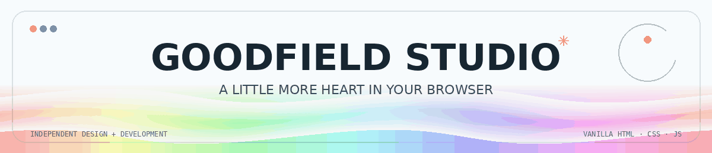
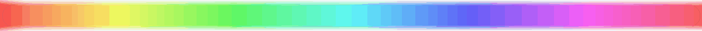

<p align="center">
  
</p>

<p align="center">
  <strong>A human-sized portfolio for a human-sized creative studio.</strong><br>
  Brand stories, useful websites, tiny details, and a few things that move when you poke them.
</p>

<p align="center">
  <code>HTML</code> &nbsp;·&nbsp; <code>CSS</code> &nbsp;·&nbsp; <code>Vanilla JavaScript</code> &nbsp;·&nbsp; <code>Matter.js</code>
</p>

<p align="center">
  
  <a href="#make-it-yours">Make it yours</a> &nbsp;·&nbsp;
  <a href="THIRD_PARTY.md">Asset credits</a>
</p>



## A note before you scroll

Goodfield is a **fictional demo studio** created to show how this template can feel when it is filled in. Project names, results, prices, testimonials, location and contact details are sample content—not real client claims. Replace them with your own before publishing.

This is a deliberately simple static site. There is no framework to install, no build command to remember, and no mystery folder full of generated files. Open `index.html`, edit the parts that sound like you, and make it your own.


## What's inside

| A little feature                   | What it does                                                                                                                               |
| ---------------------------------- | ------------------------------------------------------------------------------------------------------------------------------------------ |
| Sky-and-paper visual system        | Drifting clouds, blue gradients, warm orange details, soft grain and measured little labels.                                               |
| Long-form studio story             | Hero, selected work, studio bento, process, services, comparison, proof, contact, pricing, FAQ, playful corner and footer.                 |
| Tiny interactions                  | Custom cursor on desktop, live Lahore clock, scroll ruler, reveal-on-scroll, magnetic buttons, carousels, modal case notes and accordions. |
| Horizontal project & service rails | Touch-friendly scrolling, mouse-drag support for projects, arrow controls and service pagination.                                          |
| Choose-a-plan switch               | Updates example price, inclusions, button subject and selected state without reloading.                                                    |
| Matter.js playground               | Tap the orange button and let a few little shapes tumble around. The library is included locally.                                          |
| Mobile-friendly layout             | Navigation becomes a menu, cards stack cleanly, touch scrolling stays native.                                                              |
| Self-contained assets              | Local font files, local photos, favicon, and no remote font or image requests.                                                             |
| Animated README                    | The rainbow banner and section rules are local GIFs, so they travel with the repository.                                                   |


## Preview it

### Right here, in the repository

1. Open `index.html` in your browser for a quick look.
2. For the most reliable local preview, run a tiny static server from this folder:

   ```bash
   python3 -m http.server 8000
   ```

   On Windows, `py -m http.server 8000` works if Python is installed.

3. Visit **[http://localhost:8000](http://localhost:8000)**.
4. Stop the server with `Ctrl + C` in the terminal.

There is no `npm install` step. If you use VS Code, the **Live Server** extension is another easy way to preview the page.


## Make it yours

### 1. Change the studio name, story and links

Search the project for `Goodfield`, `GOODFIELD` and `hello@goodfield.studio`. Update:

- `index.html` — visible copy, section headings, project names, services, contact links and footer.
- `script.js` — the content behind project/service dialogs, sample notes, example plan prices, the Lahore timezone and interactive states.
- `styles.css` — colors, spacing, type sizes, cloud movement, card treatments and breakpoints.

Quick tip: use your editor's **Find in Files** to replace the email address consistently.

### 2. Replace the pictures

Put your images in `assets/images/`, then update the relative paths in `index.html`. The supplied files are:

```text
assets/images/coffee.webp
assets/images/skincare.webp
assets/images/architecture.webp
```

Keep image paths lowercase and relative. Compress large photos before adding them; the GitHub browser uploader has a **25 MiB per-file limit**. See the official [GitHub upload guidance](https://docs.github.com/en/repositories/working-with-files/managing-files/adding-a-file-to-a-repository).

### 3. Replace sample claims before launch

The displayed stats, quotes, project outcomes and prices are examples. Make sure every claim on your live portfolio is yours, approved for use, and accurate. For case studies, a clear “concept project” label is better than implying a client relationship that did not happen.

### 4. Tune the palette

The main colors live near the top of `styles.css` in `:root`:

```css
--sky: #5eaeea;
--blue: #0d99ff;
--orange: #ee5a28;
--ink: #172631;
--paper: #fffefa;
```

Change the variables first; most components use them.

### 5. Change the clock's timezone (optional)

The live clock is currently set to `Asia/Karachi` in `script.js`. Replace that timezone with an [IANA time-zone name](https://en.wikipedia.org/wiki/List_of_tz_database_time_zones) and update the visible `LAHORE` / `PKT` labels in `index.html` to suit your studio.


## Stack & structure

**The original reference is a hand-authored static page**, not a React/Next/Webflow export. Its source exposes HTML, a large inline stylesheet, native browser JavaScript and Matter.js for the physics interaction. This remake keeps that lightweight approach but separates the files so they are easier to edit and publish.

```text
goodfield-studio-portfolio-template/
├── index.html                 # all page sections and editable copy
├── styles.css                 # responsive design, motion and color system
├── script.js                  # carousels, dialogs, pricing, clocks and interactions
├── README.md                  # this animated project overview
├── THIRD_PARTY.md             # font, photo and library notes
├── LICENSE                    # MIT for the template code
├── .gitignore                 # common editor / OS / build exclusions
└── assets/
    ├── favicon.svg
    ├── fonts/                  # local WOFF2 files; no runtime font request
    ├── images/                 # local project imagery
    ├── readme-banner.gif       # animated README header
    ├── rainbow-rule.gif        # animated README section divider
    └── vendor/matter.min.js    # Matter.js 0.19.0, local/offline
```

No package manager or build step is required. The page can be served from any static host, including GitHub Pages.


## Accessibility & motion

- Navigation, carousels, pricing and FAQ controls are keyboard-operable.
- The custom cursor is limited to fine pointers; native touch behavior stays intact.
- Motion responds to `prefers-reduced-motion`.
- Images have alt text, controls have labels, dialogs can be dismissed, and the page includes a skip link.


## Credits & license

- Template code: **MIT** — see [`LICENSE`](LICENSE).
- Matter.js: **MIT**, included locally with its upstream license header.
- Local font files: Google Fonts families under the **SIL Open Font License**; details and links in [`THIRD_PARTY.md`](THIRD_PARTY.md).
- Supplied sample photographs: Pexels / Vecteezy sources and license notes in [`THIRD_PARTY.md`](THIRD_PARTY.md).
- Replace or re-license the sample photos if your use case requires it; don't imply that they are original client work.

<p align="center">
  <strong>Made slowly enough to get the small things right.</strong><br>
  <sub>Now go make it sound like you.</sub>
</p>

<p align="center">
## 🌟 Support the Project

If you find this template useful, please consider giving it a star! It helps others discover the repository and supports future development.

</div>
